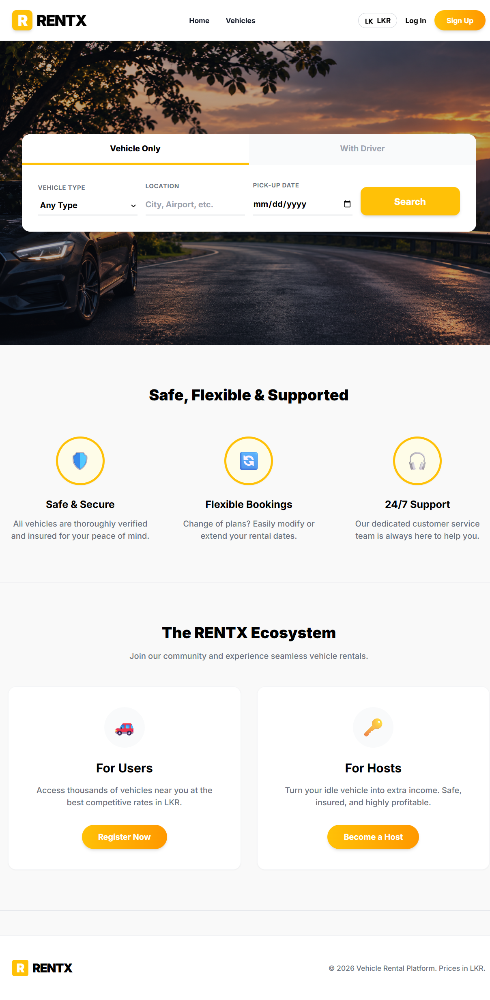
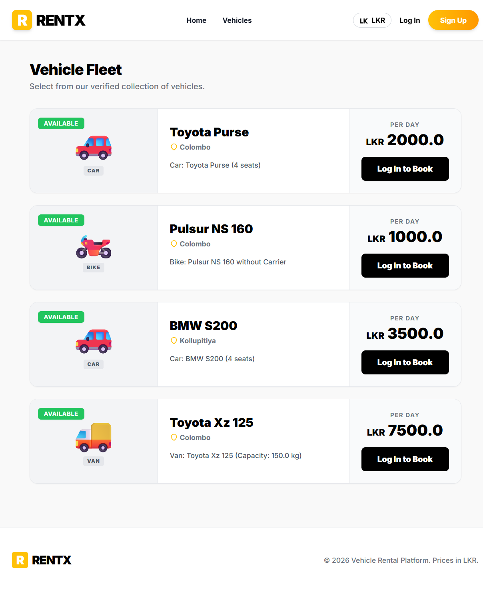
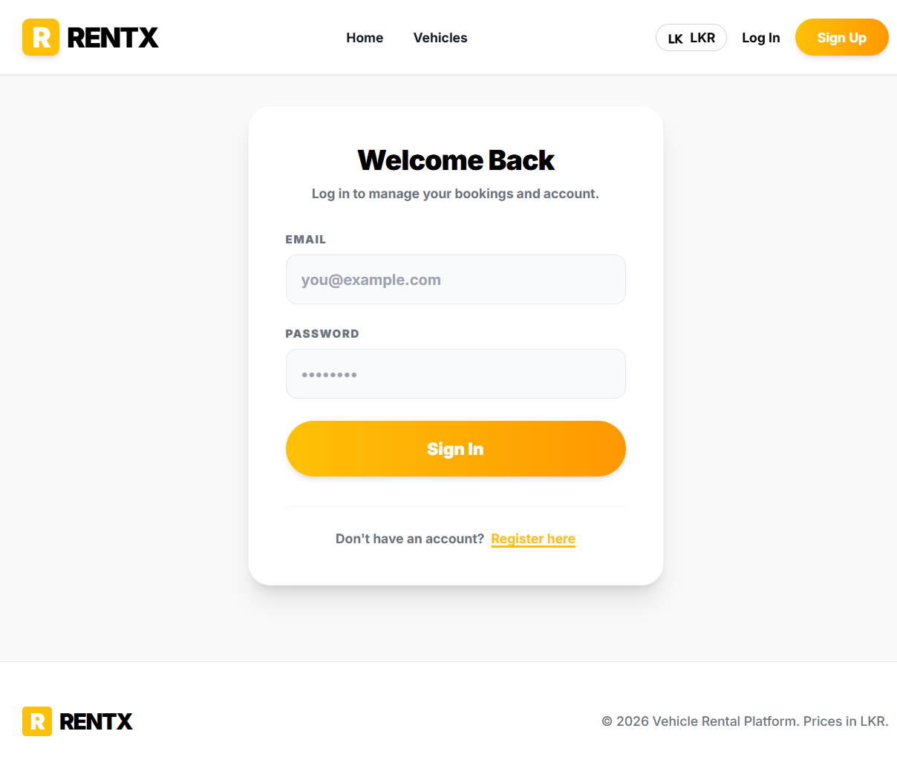
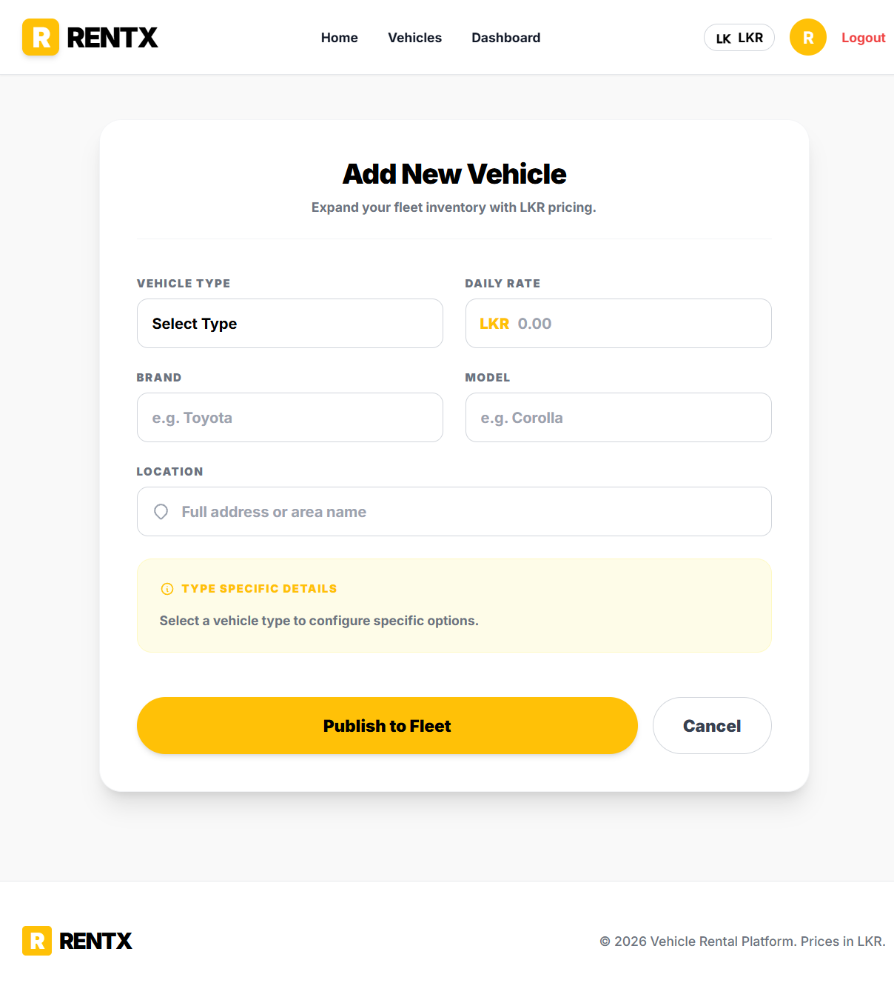
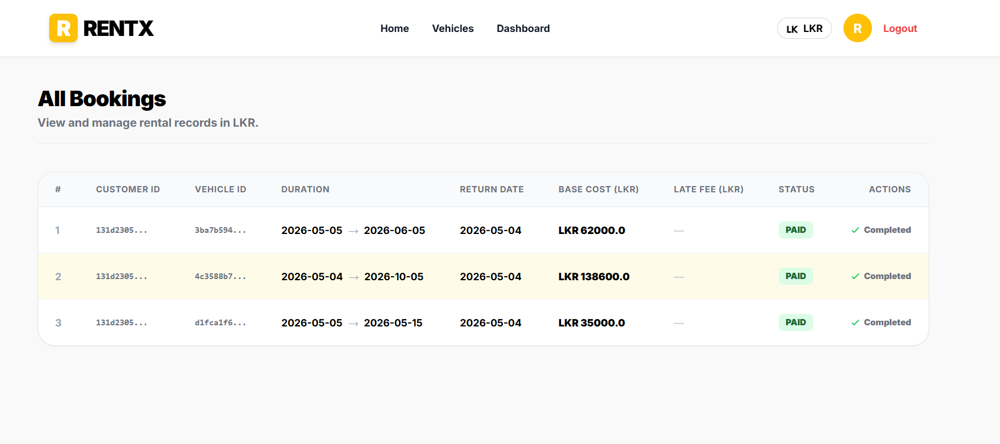

# Vehicle Rental Service Platform

This is a Spring Boot web application built for an OOP University Project.

## Tech Stack
* **Backend:** Java 17, Spring Boot 3.2.4, Spring MVC, Maven
* **Frontend:** Thymeleaf, Bootstrap 5 (via CDN), HTML5
* **Data Storage:** File-Based Storage (TXT Files)

## Object-Oriented Principles Implemented
1. **Encapsulation:** All fields in entities are `private` with public `getter` and `setter` methods.
2. **Inheritance:** An abstract `Vehicle` base class is inherited by `Car`, `Bike`, `Van`, and `Truck` entities.
3. **Polymorphism:** The `calculateRentalPrice()`, `getVehicleDescription()`, and `calculateLateFee()` methods are defined in the abstract `Vehicle` class and overridden in each subclass to provide vehicle-specific logic.
4. **Abstraction:** Core business rules are hidden behind Service layer interfaces (e.g., `VehicleService`, `BookingService`), separating logic from Controllers and Repositories.

## Setup Instructions

### 1. Prerequisites and Data Storage

#### Prerequisites
- Java Development Kit (JDK) 17
- Apache Maven
- An IDE such as IntelliJ IDEA, Eclipse, or VS Code

#### Data Storage
The application uses file-based storage instead of a relational database.

Vehicle, user, booking, and payment records are stored in text files within the `data/` directory.

No SQL Server installation or database configuration is required.

The application automatically creates the `data/` directory and the required text files when they are first accessed. No manual database setup is required.

### 2. Running in IDEs

#### IntelliJ IDEA
1. Open IntelliJ IDEA.
2. Click **File -> Open** and select the downloaded project folder containing `pom.xml`.
3. Wait for Maven to download the dependencies.
4. Open `src/main/java/com/rental/VehicleRentalApplication.java`.
5. Click the green **Run** button next to the `main` method.

#### Eclipse / STS (Spring Tool Suite)
1. Go to **File -> Import -> Maven -> Existing Maven Projects**.
2. Select the downloaded project folder containing `pom.xml` and click **Finish**.
3. Right-click the project -> **Run As -> Spring Boot App**.

#### VS Code
1. Ensure the "Extension Pack for Java" and "Spring Boot Extension Pack" are installed.
2. Open the downloaded project folder containing `pom.xml`.
3. Open the Spring Boot Dashboard.
4. Find the `VehicleRentalPlatform` application and click the **Run** icon.

### 3. Application Usage
1. Open your browser and navigate to: `http://localhost:8080`
2. **Create an Admin:** The very first user to register will automatically be assigned the `ADMIN` role.
3. **Login:** Log in with the registered credentials.
4. **Admin Dashboard:** Access the Admin Dashboard from the top navbar to add vehicles and view statistics.
5. **Customer Booking:** Register another user to act as a customer, browse vehicles, and create bookings. Admin users can process returns from the Booking History page to calculate final costs and late fees.

## Project Information

- **University:** Sri Lanka Institute of Information Technology (SLIIT)
- **Module:** Object-Oriented Programming (OOP)
- **Project Type:** University Group Project

## My Contribution

**Vehicle Management Module**

Contributed to the development of the Vehicle Management module, including vehicle registration and management functionalities.

## Acknowledgements

This project was collaboratively developed by a team of students as part of the Object-Oriented Programming module at SLIIT.

## Application Screenshots

### 1. Home Page

### 2. Vehicle Fleet

### 3. Login Page

### 4. Admin Dashboard

### 5. Add Vehicle

### 6. All Bookings

